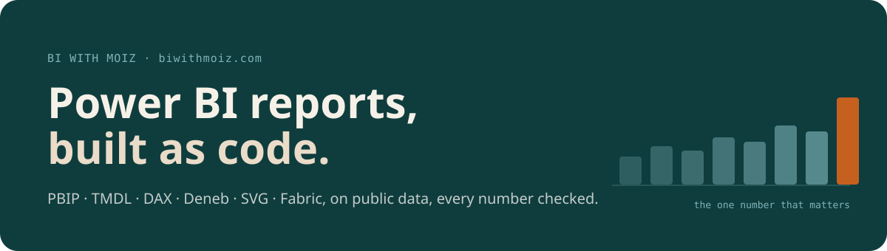
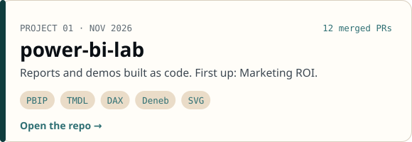
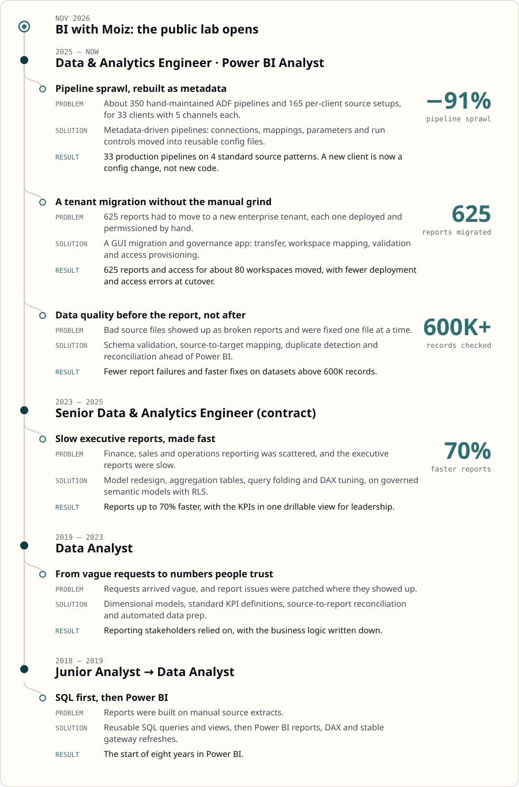

<a href="https://biwithmoiz.com">biwithmoiz.com</a> · <a href="https://www.linkedin.com/in/da-moiz-patvi">LinkedIn</a>

### Projects

<a href="https://biwithmoiz.com"><picture><source media="(prefers-color-scheme: dark)" srcset="assets/card-lab-dark.svg"></picture></a>

Every project shows when it was built, the stack used and where its data comes from.

### Career

<picture><source media="(prefers-color-scheme: dark)" srcset="assets/career-dark.svg"></picture>

Employers are left out on purpose; roles, years and results are as they happened.

### Certifications

Microsoft Certified: Fabric Analytics Engineer Associate · Microsoft Certified: Power BI Data Analyst Associate · Microsoft Certified: Azure Data Fundamentals · Databricks Lakehouse Fundamentals · IBM Machine Learning with Python · IBM Data Visualization with Python
