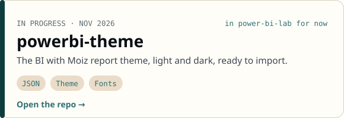

<a href="https://biwithmoiz.com">biwithmoiz.com</a> · <a href="https://github.com/MoizP-AI-Lab/power-bi-lab">power-bi-lab</a>

### Projects

<a href="https://github.com/MoizP-AI-Lab/power-bi-lab"><picture><source media="(prefers-color-scheme: dark)" srcset="assets/card-lab-dark.svg"></picture></a>
<a href="https://github.com/MoizP-AI-Lab/power-bi-lab/tree/main/shared/theme"><picture><source media="(prefers-color-scheme: dark)" srcset="assets/card-theme-dark.svg"></picture></a>

Every project shows when it was built, the stack used and where its data comes from.
